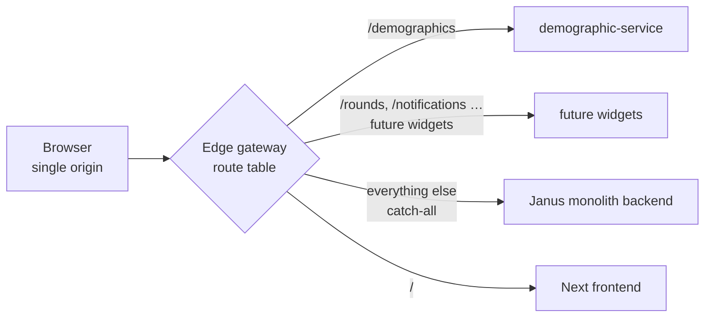

# The strangler-fig strategy

## What it is

We add new dashboard capabilities as independent Widget services that
progressively take over routes from the Janus monolith — strangling it one path
at a time — while the monolith's **code** stays byte-for-byte untouched. A single
edge gateway is the seam that decides, per request, "monolith or Widget."

## When to read it

Before adding a new Widget service, before changing how requests are routed, or
whenever you need to know *why* the gateway, the shared database, and the
separate deployables exist as one coherent move rather than three unrelated
choices. For the detailed decision records, follow the links to the ADRs; for
operating the gateway, see its [README](../edge-gateway/README.md).

## The pattern, applied here

The classic strangler fig wraps a legacy system in a facade and migrates
behaviour outward to new services until the old system is dormant. Here the
facade is the [edge gateway](../adr/0002-edge-gateway-single-front-door.md), and
the migration unit is a **route**:

- The **monolith is the default.** Every request whose path the gateway doesn't
  explicitly recognise falls through to the monolith backend. The monolith can
  add, change, or remove its own routes with **zero** gateway edits — the gateway
  respects the same "don't touch me as I evolve" contract the monolith does.
- A **Widget claims a fresh prefix.** A new service takes over a slice of
  behaviour by registering one explicit top-level prefix (`/demographics`,
  `/rounds`, `/notifications`, `/geo-layers`, and others — the current roster is
  the [services context map](../services/README.md)). Longest-prefix match
  wins; the monolith catch-all is always last.
- **Strangling a route is a one-line, reversible move.** Re-pointing a single
  route-table entry shifts a path from the monolith to a new service — and back,
  if needed.

## Why this shape

Three forces drove the design; each is recorded in full in an ADR.

- **The monolith must not be edited.** The work is developed and deployed
  separately. So new behaviour lives *outside* both monolith repos, and the only
  monolith-side change is a deployment value (`NEXT_PUBLIC_BACKEND_URL` → the
  gateway), never code. See [ADR-0002](../adr/0002-edge-gateway-single-front-door.md).
- **One browser origin, so CORS stops existing.** Before the gateway, reaching a
  Widget meant pasting its absolute host into a dashboard config, giving the
  frontend a second origin per service and forcing each service to open wide CORS
  (review warning **G3**). A single same-origin front door makes CORS
  *structurally impossible* instead of something tightened by a regex, and hands
  us one TLS-termination point (so realtime is WSS for free).
- **No data duplication.** Widget services share the monolith's Supabase Postgres
  rather than owning a datastore, keeping a single source of truth and the
  monolith-issued JWT as the one authorization model across every service and
  transport. See [ADR-0001](../adr/0001-shared-database.md).

## How it's implemented

The strategy is realised by five pieces. Each already exists in the repo; this
is the map of where to look, not a duplicate of their own docs.

| Piece | Where it lives | What it does |
| ----- | -------------- | ------------ |
| **Route table** | [`edge-gateway/Caddyfile`](../../edge-gateway/Caddyfile) | The one file that answers "where does this request go?" — explicit Widget prefixes first, monolith catch-all last. Holds **no business logic**. |
| **Per-environment config** | env substitution in the Caddyfile (`{$VAR}`) | Public hostname, upstream addresses, and the TLS toggle are injected per environment. Same file runs local/staging/prod; only values differ. The site address *is* the TLS toggle (port-only → HTTP; hostname → automatic HTTPS). |
| **Compose orchestration** | [`docker-compose.yml`](../../docker-compose.yml) | Wires gateway + monolith backend + demographic-service + Next frontend on one network, with the **gateway as the only published port**. Closes review blockers **G1** and **G2**. |
| **CORS removal** | [`demographic-service`](../services/demographic-service/README.md) | Widget services carry no CORS — they're never browser-facing. The standing pattern for every future Widget. |
| **Frontend base URL** | `NEXT_PUBLIC_BACKEND_URL` → the gateway | Both framework calls (`/dashboards`, `/auth`) and Widget calls (`/demographics`) leave the browser as relative paths against the one origin. No frontend code changes. |

The route table is the single **deep module**: a tiny interface (one origin + a
prefix table) hiding routing, TLS posture, and CORS posture. Everything else is
configuration exercised end-to-end by the gateway's
[routing-contract tests](../edge-gateway/README.md#routing-contract-tests).

## Adding a Widget

1. Build the service as its own deployable under [`services/`](../../services/),
   verifying the monolith JWT and speaking the canonical `DataResponse` contract.
2. Add **one** route to the Caddyfile: a fresh top-level prefix → the service.
3. Add the service to `docker-compose.yml` (no published port).

A Widget can own its **UI** as well as its data — shipping a self-contained
custom element the service serves, mounted by a single generic seam in the
monolith. That is the frontend half of this same strategy, written up separately:
[Full-stack Widget microservices](widget-microservice-fullstack.md).

The prefix **must** be fresh. A new service may not reuse a monolith prefix
(`/auth`, `/dashboards`, `/layers`, `/areas`, `/pollution`, `/weather`,
`/euklid`, `/pois`, `/reviews`, `/situation`, `/data-upload`) — a new layers
service claims `/geo-layers`, not `/layers`. Realtime Widgets need nothing extra:
Caddy carries WebSocket/SSE upgrades on every proxied route, so a realtime Widget
registers its prefix like any other and holds its own connection behind the
gateway (auth convention in the [gateway README](../edge-gateway/README.md#realtime-auth-convention)).

## Invariants that must hold

These are load-bearing; breaking one quietly undoes the strategy.

- **The monolith's code is never edited** — only its deployment values.
- **Same origin everywhere** — the browser only ever talks to the gateway. This
  is what makes CORS impossible and gives one TLS point.
- **Dashboard configs use relative paths only.** The frontend's `resolveUrl`
  passes any absolute `http(s)://` URL through untouched, silently bypassing the
  gateway (second origin, no TLS, CORS back). The convention is enforced, not
  cosmetic.
- **The gateway holds no business logic.** Give it widget behaviour and it
  becomes a second monolith in waiting; keep it a dumb proxy so the proxy itself
  stays the one *reversible* choice (swap Caddy for Traefik/nginx = a config
  rewrite).

## The known cost

The gateway sits on the critical path of **all** traffic, including the
previously-stable monolith — a new single point of failure. This is the normal,
understood price of a reverse proxy. It is mitigated by treating the gateway as
*replacing* the existing production ingress (not stacking a new tier) and by
choosing a battle-tested proxy.

## Links out

- [ADR-0001 — Shared database](../adr/0001-shared-database.md)
- [ADR-0002 — Edge gateway, single front door](../adr/0002-edge-gateway-single-front-door.md)
- [Edge gateway README](../edge-gateway/README.md) — operating the seam: tests, compose, reachability smoke, realtime.
- [Architecture review](../architecture-review-strangler-fig-20260601.html) — blockers G1/G2/G3.
- Back to the [project map](../../README.md).
